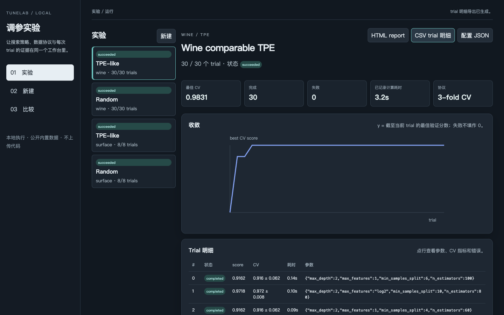

# TuneLab

在线体验（回放数据）：https://jstar0.github.io/tunelab/

TuneLab turns a search space and an objective function into a reproducible experiment: every trial is recorded, checkpoints are atomic, interrupted runs resume, and the result is readable as JSON, CSV, or a self-contained HTML report.

It is deliberately small and transparent. The package is useful when you need to compare search strategies without hiding the dataset, seed, metric, or failed evaluations behind a dashboard.

## Quick start

Requires Python 3.11+ and [uv](https://docs.astral.sh/uv/).

```bash
uv sync --extra dev
uv run tunelab demo --output-dir outputs/demo
open outputs/demo/benchmark.html
```

The demo evaluates the same deterministic synthetic objective with grid, random, TPE-like, and genetic search. It writes one report per strategy plus `benchmark.json`, `benchmark.csv`, and `benchmark.html`. Be clear about what it shows: the surface is clamped at 1.0, and at the default 48 trials **all four strategies reach exactly 1.0**. The demo proves the orchestration runs end to end and reproduces byte for byte. It does not rank the strategies, and nothing here could.

Run a single experiment:

```bash
uv run tunelab run \
  --objective wine \
  --algorithm tpe \
  --trials 12 \
  --seed 7 \
  --output-dir outputs/wine-tpe
```

The command creates `checkpoint.json` by default. Re-running the same command resumes from that checkpoint and writes `run.json`, `trials.csv`, and `report.html`.

To exercise the recovery path intentionally:

```bash
uv run tunelab recovery-demo --trials 8 --fail-after 3 \
  --output-dir outputs/recovery-demo
```

The command intentionally stops after the third new trial, then resumes the
same random sequence from its atomic checkpoint. It leaves `checkpoint.json`,
`observations.json`, canonical result, trial CSV and HTML report together so a
reviewer can inspect recovery rather than trust a sentence about it.

## What is included

- Typed parameter declarations for integer, float, categorical, and boolean values.
- Grid, seeded random, dependency-free TPE-inspired, and genetic proposals.
- Objective failures recorded as failed trials instead of destroying the run.
- Atomic JSON checkpoints and configuration-digest validation.
- Built-in synthetic surface plus public Iris/Wine RandomForest objectives.
- A Wine-based default benchmark and seed sweep; Iris remains available as an
  explicit compact reference objective.
- Stable JSON/CSV/HTML reports with convergence and failure visibility.

The `tpe` strategy is intentionally named **TPE-like** in the implementation and documentation: it uses a warm-up, good-set split, and local density-inspired proposals. It is not presented as a drop-in replacement for Optuna or a full Bayesian optimizer. This keeps the core dependency-light and makes the behavior inspectable.

## Python API

```python
from tunelab import SurfaceObjective, run_experiment

objective = SurfaceObjective()
result = run_experiment(
    run_id="surface-tpe-seed42",
    objective=objective,
    objective_name=objective.name,
    specs=objective.specs,
    algorithm="tpe",
    max_trials=24,
    seed=42,
)
print(result.best_score, result.best_trial.params if result.best_trial else None)
```

For a custom objective, return `ObjectiveResult(score=..., metrics={...})`. Scores are maximized. Keep the objective deterministic for reproducible comparisons, or record every external source of randomness in your own manifest.

## Reproducibility contract

TuneLab records the run identifier, objective name, search space, algorithm, seed, trial parameters, scores, metrics and errors in the canonical checkpoint/result. Actual evaluation durations and start/end observations are written separately to `observations.json`: they are visible in the workbench but excluded from canonical result artifacts because they depend on the machine. Older checkpoints whose historical duration is `0` show as **未记录**, not as a measured zero. A checkpoint is accepted only when its configuration digest matches the requested run **and** its trial sequence has contiguous numbering, schema-matching parameter keys, unique in-space configurations, valid states, and in-bounds parameter values. Reports also state why a score should not be compared across different data, splits, metrics, or code versions.

## Local workbench

Build the React client once, then start the same-origin local service:

```bash
cd web && pnpm install && pnpm build
cd .. && uv run tunelab serve --host 127.0.0.1 --port 5202
```

Open <http://127.0.0.1:5202/>. The workbench creates immutable runs from a
named objective, full parameter space, budget and seed. It persists actual
trial progress, permits pause/cancel only after the current trial, resumes an
interrupted run against the same configuration digest, and separates canonical
JSON, observations, CSV trial detail, HTML report and frozen config downloads.
Comparison checks objective, data seed, CV folds, space and budget before it
allows a same-budget reading; otherwise it keeps the results side by side
without naming a winner.

The comparison view also keeps every selected `search_seed` visible and groups
completed selected runs by strategy. It reports the group count, mean best CV
and population standard deviation; that small-sample description is never
presented as a confidence interval or an algorithm ranking. The Surface form
offers an explicitly labelled failed-trial tutorial: GELU candidates raise a
recorded tutorial error while the other candidates continue. It is for
inspecting failure rows and recovery behavior, not for evaluating strategies.



The checked-in local evidence command is:

```bash
uv run tunelab sweep --objective wine --seeds 17,29,41 --trials 8 --folds 3 \
  --output-dir outputs/wine-three-seed
```

On the current machine this produces a fixed-data, three-seed descriptor where
grid reaches mean best CV `0.94369115`, random and genetic `0.98305085`, and
TPE-like `0.98119900` with population σ `0.00261892`. These are observations
of one public Wine protocol and eight-trial budget, not a universal ranking.

## Development

```bash
uv run pytest
uv run --with ruff ruff check src tests
uv build
```

See [docs/architecture.md](docs/architecture.md) for the data flow.

## Scope and limits

TuneLab is an inspectable orchestration layer, not a competitor to a mature
tuning framework. These boundaries are real and worth knowing before reading any
number it produces:

- **`tpe` is not a Tree-structured Parzen Estimator.** It warms up randomly,
  then anchors on the top 25% of history and proposes Gaussian neighbours.
  There is no density model and no expected-improvement acquisition. The name
  is a familiar label for a much simpler policy.
- **`genetic` is a steady-state GA**: top-third parents, uniform crossover,
  0.25 mutation rate. There are no discrete generations and no explicit
  elitism step.
- **The synthetic surface and Iris remain score-saturated.** The 450 Iris grid
  points yield only four distinct scores and 154 tie at the maximum 0.96; the
  synthetic surface is clamped at 1.0. The default Wine contract is less
  saturated: under seed 17, the same 450-point grid yields 16 distinct scores
  and 26 maximum-score ties. That makes a small-budget comparison more useful,
  but it is still one public dataset and not evidence that one strategy wins.
- **All four strategies search the same finite grid.** Every numeric spec sets a
  step, and float draws are snapped back onto it, so "random search" is
  discrete-uniform over the grid and grid search under a small budget is a
  lexicographic prefix scan.
- **The three stochastic strategies emit identical first four trials**, because
  the RNG is reseeded per trial index and both adaptive strategies warm up
  randomly. At the default budget of 8 that leaves four adaptive proposals each.
- **The default sweep fixes the data/model seed at 2026 and varies only search
  seeds.** This makes strategy comparisons cleaner, but it measures one fixed
  data split rather than robustness across different splits. `--data-seed` is
  recorded in every sweep artifact when that boundary must be changed.
- **Three seeds, no significance test.** The sweep reports mean and population
  sigma. That is a stability descriptor, not evidence that one strategy wins.
- **Budget means unique configurations**, not wall-clock or objective cost, and
  no configuration is ever evaluated twice.
- **No parallelism, no pruning, no early stopping.** Trials run sequentially and
  always to completion.
- **Objective failures and adapter-contract errors differ.** An exception raised
  by an objective becomes a recorded failed trial so recovery remains possible.
  A value that is not an `ObjectiveResult` stops the run before an invalid trial
  can enter its checkpoint.
- **Policy constants are readable defaults, not tuned values** (warm-up 4,
  good-set quantile 0.25, sigma factor 0.18, parent fraction one third,
  mutation rate 0.25).


## Scope

This is an independent implementation. It uses no client code, client data, client assets, private prompts, or copied source files. The design is informed by general experience building structured-data tuning workflows; names, APIs, tests, and documentation are new.

## License

MIT; see [LICENSE](LICENSE).
